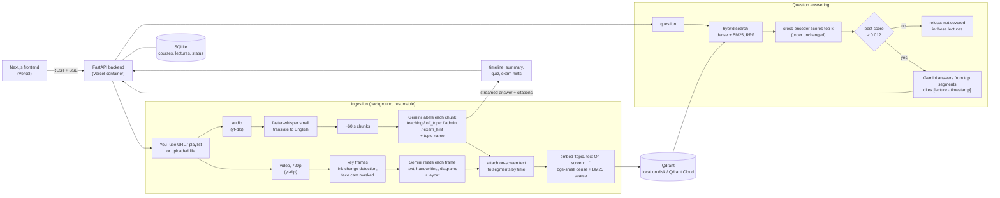

# LectureLens

**Ctrl+F for your entire semester of lectures.** Ask a question, get an answer grounded only in what was taught, and jump to the exact second the lecturer explained it.

> Status: work in progress. Search, cited answers, summaries, topic timelines, quizzes and reading the screen from the video work. Not built yet: uploading separate slide PDFs, and cropping/upscaling far-away boards.

**Live demo:** https://lecturelens-app.vercel.app (read-only, over CampusX's "100 Days of Machine Learning" lectures; the first request after a quiet spell takes a few extra seconds while the backend starts).

## What it does

- **Ingests lectures** from a YouTube video, a whole playlist, or a local media file.
- **Transcribes with timestamps** using Whisper, running locally. Hindi/Hinglish lectures are translated to English during transcription.
- **Labels every segment** as teaching, off-topic, admin or exam hint, and names its topic.
- **Reads the screen.** Picks the key frames of the video (each page or slide at its fullest), has a vision model read the typed text, handwriting, code and diagrams on them, detects the lecture's layout (screen, screen + face cam, talking head, board), and attaches what was on screen to the transcript at that moment. Questions about something only written down, never said, can then be answered.
- **Answers questions with citations.** Each claim links to a lecture and timestamp; clicking it seeks the video.
- **Refuses when the lectures don't cover it**, and shows the closest moments instead of guessing.
- **Summarises each lecture** with timestamped key points and a clickable topic timeline that greys out off-topic stretches.
- **Generates practice quizzes** from a lecture's own content, each question linked to the moment it was explained.

### Why not just ask a chatbot?

| General chatbot | LectureLens |
|---|---|
| Can't take in 40+ hours of video | Transcribes and indexes the whole course |
| Answers from general knowledge | Answers only from your lectures, or says "not covered" |
| No timestamps | Jumps to the exact moment in the video |
| No proof of accuracy | Measured with an evaluation set |

## How it works



Ingestion caches the transcript, the labels, the key frames and their reads on disk per lecture, so a restart picks up where it stopped. Search and the exam-hint / announcement views filter on the chunk labels; off-topic chunks are left out of answers unless the user asks for them.

| Layer | Choice |
|---|---|
| Backend | FastAPI, SQLite (SQLModel) |
| Transcription | faster-whisper (`small`, CPU, translate mode) |
| Embeddings | `BAAI/bge-small-en-v1.5` via fastembed (ONNX, no PyTorch) |
| Vector store | Qdrant: dense + BM25 sparse vectors, fused with RRF. Embedded on disk locally, Qdrant Cloud when deployed |
| Confidence scorer | `Xenova/ms-marco-MiniLM-L-6-v2` cross-encoder (scores the hits for the refusal gate; does not reorder them) |
| LLM | Gemini (answers and segment labels), model set in `.env` |
| Screen reading | Key frames picked with PyAV + NumPy; read by Gemini (`VISION_MODEL`, defaults to the LLM model), 6 frames per call |
| Frontend | Next.js 16, Tailwind |

Every model name and key is read from `.env`.

## Run it locally

Requirements: Python 3.11+ with [uv](https://docs.astral.sh/uv/), Node 20+, and a Gemini API key. No Docker, GPU or ffmpeg needed.

```bash
# 1. Configure
cp .env.example .env          # then set GEMINI_API_KEY

# 2. Backend  (http://localhost:8000, API docs at /docs)
cd backend
uv sync
uv run uvicorn app.main:app

# 3. Frontend (http://localhost:3000)
cd frontend
npm install
npm run dev
```

Open http://localhost:3000, create a course, and paste a YouTube video or playlist URL. Lectures are processed one at a time; on a laptop CPU, expect several minutes per lecture. If the backend restarts, unfinished lectures resume automatically.

## Deploying a public demo

Transcription is too heavy for free hosting, so the demo is **read-only**: lectures are processed locally, then a snapshot of the index is baked into the backend image. Visitors can search, ask, read summaries and take quizzes, but cannot add lectures.

```bash
cd backend
uv run python scripts/make_snapshot.py     # stop the backend first; writes backend/snapshot/
docker build -t lecturelens-api .
docker run -p 7860:7860 -e GEMINI_API_KEY=... -e LLM_MODEL=... lecturelens-api
```

The image sets `READ_ONLY=true` and limits each visitor to 10 LLM-backed requests per minute (`RATE_LIMIT_PER_MIN`). It uses about 700 MB of RAM, so it needs a host with at least 1 GB. Set `CORS_ORIGINS` on the backend to the frontend's URL, and `NEXT_PUBLIC_API_URL` on the frontend to the backend's URL.

The live demo runs both halves on Vercel. `scripts/build_space.py` writes `deploy/space/` with a `Dockerfile.vercel`, which Vercel builds as a container:

```bash
uv run python scripts/build_space.py
cd ../deploy/space && vercel link --project lecturelens-api && vercel deploy --prod
```

## Evaluation

`eval/questions.jsonl` holds questions with the lecture and time range where each is answered, plus questions the lectures do not cover.

```bash
python eval/run.py --course 1     # backend must be running
```

This compares dense, BM25, hybrid and hybrid + rerank retrieval and reports Recall@1, Recall@5, MRR and timestamp accuracy (top result within ±30s of the gold span). Results are saved to `eval/results/`.

### Results

66 questions over the 5 indexed lectures: 55 with a gold lecture and time range (factual, conceptual, "where does he explain…", course info) and 11 the lectures do not cover. Run on 2026-11-13 against the deployed backend; latency includes the network round trip.

| Retrieval | Recall@1 | Recall@5 | MRR | Timestamp ±30s | Median latency |
|---|---|---|---|---|---|
| Dense | 0.93 | **1.00** | 0.95 | 0.87 | 405 ms |
| BM25 | 0.82 | 0.98 | 0.89 | 0.76 | 414 ms |
| Hybrid (RRF) | **0.96** | **1.00** | **0.98** | **0.89** | 405 ms |
| Hybrid + confidence score (live setup) | **0.96** | **1.00** | **0.98** | **0.89** | 939 ms |
| Hybrid + confidence score, off-topic kept | 0.96 | 1.00 | 0.98 | 0.89 | 950 ms |

**With 10 lectures (2026-11-23).** The demo now indexes lectures 1–10 of the playlist. The questions are unchanged (they all come from lectures 1–5), so lectures 6–10 only add distractors. Run against a local backend on CPU, so latencies aren't comparable with the table above (the cross-encoder is much slower locally). Results: `eval/results/20261123-050402.md`.

| Retrieval (10 lectures) | Recall@1 | Recall@5 | MRR | Timestamp ±30s |
|---|---|---|---|---|
| Dense | 0.87 | 0.98 | 0.92 | 0.84 |
| BM25 | 0.78 | 0.98 | 0.87 | 0.75 |
| Hybrid (RRF) | **0.95** | **1.00** | **0.97** | **0.91** |
| Hybrid + confidence score (live setup) | **0.95** | **1.00** | **0.97** | **0.91** |

Twice as many lectures cost hybrid one question at rank 1 (0.96 → 0.95) and dense more (0.93 → 0.87). Three uncovered questions now pass the score gate instead of two: "deploying with Flask" (0.93, lecture 10's general talk about model deployment), "bias-variance trade-off" (0.77, as before) and "who won the 2019 Cricket World Cup" (0.06, lecture 7's T20 World Cup example of sampling bias). The LLM refuses all three, checked locally and, for Flask, on the live demo. The answer-quality results below were generated on the 5-lecture index.

What this shows so far:

- Hybrid retrieval beats either retriever alone at rank 1. BM25 on its own is weakest, possibly because the transcripts are machine translations with misspelt terms (not yet checked).
- Reranking does not help on this set. Hybrid alone already finds the right passage in the top 5 every time. Five cross-encoders (MiniLM-L-6/L-12, jina tiny/turbo, bge-base) re-sorting 10, 20 or 30 candidates all lowered rank-1 accuracy (to 0.87–0.93); blending their ranking with the hybrid ranking at best matched it, except jina-turbo (0.98), which let 5 of the 11 uncovered questions through the refusal gate. Full table: `eval/results/rerank-sweep-20261113-032207.md` (made by `backend/scripts/rerank_sweep.py`). So the app keeps the hybrid order and uses the small MiniLM-L-6 cross-encoder only to score the top hits for the refusal gate (the earlier L-12 re-sort on 30 candidates took 5.6 s per search).
- Filtering off-topic segments changes nothing on this set, as almost no questions target off-topic talk.
- Refusals: the gate uses the best cross-encoder score among the hits. 9 of the 11 uncovered questions score 0.002 or less, while the lowest answerable question scores 0.087, so the threshold (0.01) refuses those 9 without refusing any real question. Two near misses score high ("bias-variance trade-off" 0.77, "deploying with Flask" 0.74) because lecture 1 lists them as upcoming topics, so for these the refusal relies on the LLM rather than the score threshold. Asking the live demo both questions (2026-11-13) gave the "not covered" reply with the closest moments linked, so they are refused end to end. The answer-quality run below confirms this for all 11.

**Visual-only questions (2026-11-27).** 10 more questions (`"type": "visual"` in the question file, reported in their own table by `eval/run.py`) whose answer is on the screen but not in the speech, e.g. "Which AWS services does the data engineer job posting ask for?" or "In the anomaly detection example, which two aircraft engine features are plotted?". Each was written from the frame reads and checked against the transcript text: the key words are never said, or the transcript mishears them (the speaker's "Vowpal Wabbit" is transcribed "Vopal Babit"). Lectures 1 and 2 are talking-head videos with nothing to read, so the questions come from lectures 3–10. Hybrid retrieval, 10 lectures:

| Index | Visual-only R@1 | Visual-only R@5 | Visual-only MRR | Timestamp ±30s | Transcript questions R@1 |
|---|---|---|---|---|---|
| Transcript only | 0.40 | 0.70 | 0.49 | 0.30 | 0.95 |
| **Transcript + on-screen text (app)** | **0.90** | **1.00** | **0.95** | **0.80** | 0.95 |

The on-screen text changes nothing for the 55 transcript questions. Asked end to end through the local pipeline, 9 of the 10 visual questions got the right answer with a citation to the right moment; the tenth ("Where does he show the Vowpal Wabbit library?") was refused even though the right segment was retrieved first. All 11 uncovered questions are still refused. Caveat: 10 questions, written by someone who had read the frame text, so they likely favour wording the reader picked up; treat the gain as an indication, not a measurement. Results: `eval/results/ablations-20261127-011610.md`.

Caveats: 57 of the 66 questions were written from the transcripts and checked by reading the transcript text, not by watching the video for each one (marked `"status": "skimmed"`). The transcripts are Whisper's English translation of Hinglish speech, so a gold answer can carry a translation error the video would reveal. The set is small. Treat these numbers as a first baseline.

### Ablations

```bash
backend/.venv/Scripts/python backend/scripts/ablate.py --course 1
```

The script changes one factor at a time and rebuilds a throwaway in-memory index from the cached transcripts, using the app's own chunking, indexing and search code. The live index isn't touched and no LLM calls are made. It uses the same 55 answerable questions and the same hit rule as above. With 55 questions, one question is worth about 0.02, so gaps of 0.02 to 0.04 are 1 or 2 questions. Full tables: `eval/results/ablations-20261118-024509.md`.

**Chunk length** (hybrid, classifier off, because the cached labels only fit 60 s chunks):

| Target length | Chunks | Recall@1 | Recall@5 | MRR | Timestamp ±30s |
|---|---|---|---|---|---|
| 30 s | 204 | 0.84 | 1.00 | 0.90 | 0.85 |
| **60 s (app)** | 100 | **0.93** | 1.00 | **0.96** | **0.89** |
| 90 s | 66 | 0.87 | 1.00 | 0.93 | 0.75 |
| 120 s | 51 | 0.89 | 1.00 | 0.94 | 0.64 |

Longer chunks overlap the gold span more easily, so they should score well on recall by construction. Even so, 60 s is best on every metric. The real cost of long chunks shows in timestamp accuracy: at 120 s, the top hit starts within 30 s of the answer only 64% of the time, so a click lands too early. 30 s chunks are too short to carry the context a question needs.

**Embedding model** (60 s chunks, classifier on, measured on this laptop's CPU):

| Model | Dense Recall@1 | Hybrid Recall@1 | Hybrid MRR | Index time | Query (dense) |
|---|---|---|---|---|---|
| **bge-small-en-v1.5 (app)** | **0.93** | **0.96** | **0.98** | 7 s | 12 ms |
| bge-base-en-v1.5 | 0.91 | 0.95 | 0.97 | 36 s | 28 ms |
| all-MiniLM-L6-v2 | 0.89 | 0.95 | 0.97 | 11 s | 8 ms |
| gte-base | 0.89 | 0.93 | 0.96 | 37 s | 27 ms |
| jina-embeddings-v2-small-en | 0.93 | 0.93 | 0.96 | 12 s | 12 ms |
| granite-embedding-small-english-r2 | 0.89 | 0.89 | 0.94 | 24 s | 16 ms |

The larger base-size models don't beat bge-small here and take 5 times as long to index. Every model finds the gold passage in the top 5 except jina-small dense (0.96).

**Segment classifier** (60 s chunks, bge-small, hybrid):

| Labels used for | Recall@1 | MRR |
|---|---|---|
| Nothing | 0.93 | 0.96 |
| Off-topic filter only | 0.93 | 0.96 |
| Topic prefix only | 0.96 | 0.98 |
| **Both (app)** | 0.96 | 0.98 |

Embedding each chunk with its classifier topic in front gains 2 questions. The off-topic filter changes nothing, because no question in this set targets off-topic talk; its job is to keep chit-chat out of answers, which this set doesn't test.

**On-screen text**: see the visual-only table under Results (made with `ablate.py --only visual`).

**Whisper model size** (60 s chunks, bge-small, classifier off; transcripts made with `backend/scripts/transcribe_variant.py`, results in `eval/results/ablations-20261119-132809.md`):

| Whisper | Hybrid R@1 | Hybrid MRR | Hybrid TS ±30s | Dense R@1 | Dense TS ±30s | Transcribe speed (CPU) |
|---|---|---|---|---|---|---|
| small (app) | **0.93** | **0.96** | **0.89** | **0.91** | **0.87** | faster |
| medium | 0.91 | 0.95 | 0.87 | 0.85 | 0.82 | 1.2x to 1.85x real time |

Recall@5 is 1.00 for both. `medium` is no better for retrieval and several times slower, so the app keeps `small` and `large-v3` was not run. Caveat: the gold timestamps and questions were written against the `small` transcripts, which may favour `small` slightly.

### Answer quality

```bash
backend/.venv/Scripts/python eval/judge.py --course 1   # runs the answer pipeline locally, then grades
```

`eval/judge.py` asks all 66 questions through the same pipeline the app uses, then has a separate, larger Gemini model (`gemini-3.6-flash`) grade each answer. Answers are written by `gemini-3.5-flash-lite`. The grader splits each answer into claims, checks each claim against the retrieved excerpts and against the excerpt it cites, and compares the answer with the gold answer. Refusals are counted from the answer text, without the grader. Run on 2026-11-16 to 2026-11-27.

**Partial:** 53 of the 55 answers are graded so far. The free tier allows about 20 grading calls a day, and the model is often overloaded, so grading is being finished a few answers at a time. The refusal rows cover all 66 questions.

| Metric | Result |
|---|---|
| Covered questions answered (not refused) | 55 / 55 |
| Uncovered questions refused | 11 / 11 (9 by the score gate, 2 by the LLM: bias-variance, Flask) |
| Claims supported by the retrieved excerpts | 115 / 116 claims (99%) |
| Claims supported by the excerpt they cite | 98% |
| Answers with every claim supported | 52 / 53 |
| Answers that address the question | 53 / 53 |
| Agrees with the gold answer (grader) | 52 / 53 "yes", 1 "no" |

The two flagged answers: q35 ("What is association rule learning?") has one claim of four, "a powerful application of unsupervised learning", that its cited excerpt doesn't say; the rest is supported. q36 ("Where does he tell the story about beer and baby diapers?") answers only "in Lecture 3" with a timestamp citation, which is right but leaves out the story, so the grader marks it as not matching the gold answer.

**Checking the grader:** 20 answers picked at random were labelled by hand, blind to the grader's verdicts (`eval/results/judge-20261116-134851-labels.md`). On the 19 of them graded so far, the grader agrees with the human on faithfulness 19 of 19 times and on matching the gold answer 16 of 19 times. All three disagreements (q25, q53, q19) are answers that leave out part of the gold answer: the human marked them "partly", the grader "yes". So the grader is lenient about incomplete answers, and the gold agreement above overstates completeness (the human marked 3 of 20 answers "partly"). All 20 hand-labelled answers were faithful, so this check shows that the grader doesn't flag good answers by mistake, but not that it catches unfaithful ones.

These answers were generated on the 5-lecture, transcript-only index, before screen reading existed.

One grading bug was found and fixed. The grader first saw excerpts without their lecture titles, so it flagged an answer (q4) that correctly named its lecture as unsupported. Excerpts now carry the same lecture header the answering model sees; regraded, q4 has all 3 claims supported.

## Tests

```bash
cd backend
uv run pytest
```

## Project layout

```
backend/app/
  ingestion/    acquire, transcribe, chunk, classify, pipeline
    visual/     frames (key frames), read (vision model + layout), align (text -> segments)
  retrieval/    store (Qdrant), search (hybrid + cross-encoder score)
  generation/   llm, answer (prompt, citations, SSE stream)
  api.py        REST endpoints
frontend/       Next.js app: course list, player + transcript, chat
eval/           question set, retrieval and answer-quality evaluation scripts
backend/scripts/add_visual.py   read the screen for lectures indexed before screen reading existed
```

## Content note

Lecture videos are played through YouTube embeds and are not redistributed. Only use lectures you have the right to process.
